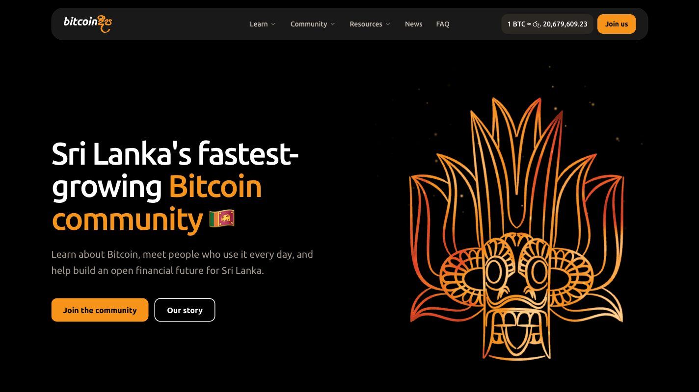

<br>

<p align="center"><a href="https://bitcoindeepa.com"><picture><source media="(prefers-color-scheme: dark)" srcset=".github/readme/wordmark-dark.svg"></picture></a></p>

<p align="center">The website of Sri Lanka's Bitcoin-only education community.<br><strong>Live at bitcoindeepa.com</strong>, open source and MIT licensed.</p>

<p align="center">
  <a href="https://bitcoindeepa.com"><picture><source media="(prefers-color-scheme: dark)" srcset=".github/readme/pill-website-dark.svg"></picture></a>
  <a href="https://t.me/BitcoinDeepa"><picture><source media="(prefers-color-scheme: dark)" srcset=".github/readme/pill-telegram-dark.svg"></picture></a>
  <a href="https://x.com/pearlofsatoshi"><picture><source media="(prefers-color-scheme: dark)" srcset=".github/readme/pill-x-dark.svg"></picture></a>
  <a href="LICENSE"><picture><source media="(prefers-color-scheme: dark)" srcset=".github/readme/pill-license-mit-dark.svg"></picture></a>
  <a href="https://github.com/bitcoindeepa/.github/blob/main/CONTRIBUTING.md"><picture><source media="(prefers-color-scheme: dark)" srcset=".github/readme/pill-contribute-dark.svg"></picture></a>
</p>

<br>

<a href="https://bitcoindeepa.com"></a>

## What's on it

| | Page | What it is |
| :-: | --- | --- |
|  | **[Home](https://bitcoindeepa.com)** | What we do, the Sinhala Bitcoin book, the Bolt Card, upcoming events and the FAQ |
|  | **[About](https://bitcoindeepa.com/about)** | Our story since the first Ceylon Bitcoin Meetup in 2022 |
|  | **[Community](https://bitcoindeepa.com/community)** | Where the community talks and meets, with moments from past meetups |
|  | **[News](https://bitcoindeepa.com/news)** | Posts from [blog.bitcoindeepa.com](https://blog.bitcoindeepa.com) |
|  | **[Release notes](https://bitcoindeepa.com/releases)** | What's new in this site, the wallet bot and the Mini App |
|  | **[Brand guidelines](https://bitcoindeepa.com/brand)** | Logo, app icon, colours, type and the downloadable asset kit |
|  | **[Sats converter](https://bitcoindeepa.com/satoshi-to-usd-and-lkr-converter)** | Sats, BTC, USD and LKR at live rates |

## Run it

```bash
git clone https://github.com/bitcoindeepa/website.git
cd website
corepack enable          # uses the pnpm version pinned in package.json
pnpm install
cp .env.example .env.local
pnpm dev
```

Then open [localhost:3000](http://localhost:3000). You need a current Node.js LTS.

- **No keys needed to start.** News falls back to the blog's public RSS feed; only the events section stays empty.
- **`pnpm build`** builds for production and type-checks. `pnpm typecheck` does just the check.
- **Never put a secret in a `NEXT_PUBLIC_` variable.** Those ship to the browser.

<details>
<summary><strong>Environment variables</strong></summary>

<br>

| Variable | What it does |
| --- | --- |
| `GHOST_API_URL` | Base URL of the Ghost blog, for the News page |
| `GHOST_CONTENT_API_KEY` | Ghost Content API key, used with `GHOST_API_URL` |
| `NEXT_PUBLIC_LUMA_CALENDAR_ID` | Luma calendar for the events section |
| `NEXT_PUBLIC_UUID` | Access token for the events API, used with the calendar ID |
| `GITHUB_TOKEN` | Higher GitHub API rate limits for the Release notes page |
| `NEXT_PUBLIC_GA_MEASUREMENT_ID` | Google Analytics 4; loads only after a visitor allows analytics |
| `NEXT_PUBLIC_C15T_BACKEND_URL` | Consent backend; defaults to `https://consent.ceylabs.io` |
| `NEXT_PUBLIC_BASE_URL` | Canonical site URL; defaults to `https://www.bitcoindeepa.com` |

</details>

## What it's made of

[Next.js 16](https://nextjs.org) on the App Router, [TypeScript](https://www.typescriptlang.org) and
[Tailwind CSS 4](https://tailwindcss.com). Motion from [Framer Motion](https://motion.dev) and
[Lenis](https://lenis.darkroom.engineering), the 3D Bolt Card from [React Three Fiber](https://r3f.docs.pmnd.rs),
icons from [Lucide](https://lucide.dev), and cookie consent from [c15t](https://c15t.com).

```text
src/
├── app/          # Every route: home, about, community, news, releases, brand, converter, legal, API
├── components/   # Page sections, nav, footer, the 3D card, and ui/ primitives
├── lib/          # Site config, SEO, news, releases, consent and price helpers
├── hooks/
└── types/
public/           # Images, media, and the brand asset kit in public/assets/brand
```

## Help out

Fix a typo, improve a page or bring the copy into Sinhala. Read the
[contributing guide](https://github.com/bitcoindeepa/.github/blob/main/CONTRIBUTING.md), then open an issue or
say hello on [Telegram](https://t.me/BitcoinDeepa). Security problems go through the
[security policy](https://github.com/bitcoindeepa/.github/blob/main/SECURITY.md), not a public issue.

## Licence

[MIT](LICENSE) for the code in this repository: use it, change it, build on it.

The Bitcoin Deepa name, "Pearl of Satoshi", the Yaka mask, the දීප glyph and the logos (including everything in
`public/assets/brand`) are trademarks of CeylonCash and not part of the licence. See
[TRADEMARK](https://github.com/bitcoindeepa/.github/blob/main/TRADEMARK.md) and the
[brand guidelines](https://bitcoindeepa.com/brand).

<br>

<p align="center"><sub>A CeylonCash community initiative · Colombo, Sri Lanka 🇱🇰 · <a href="mailto:hello@bitcoindeepa.com">hello@bitcoindeepa.com</a></sub></p>
